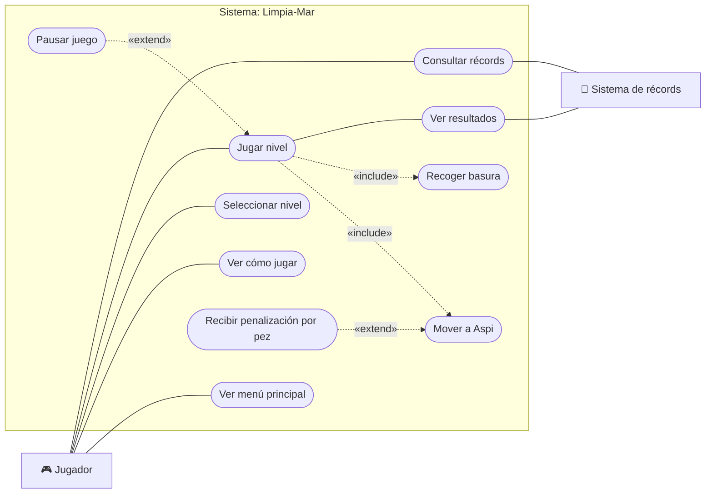

# Diagrama de casos de uso

**Actores**
- **Jugador:** la persona que juega.
- **Sistema de récords:** actor secundario que guarda los mejores puntajes en un archivo.

**Relaciones**
- «include»: *Jugar nivel* siempre incluye *Mover a Aspi* y *Recoger basura*.
- «extend»: *Recibir penalización* extiende a *Mover a Aspi* solo cuando Aspi toca un pez.
- «extend»: *Pausar juego* extiende a *Jugar nivel* solo si el jugador presiona Esc.

| Caso de uso | Descripción |
|---|---|
| Ver menú principal | Pantalla con Jugar, Cómo jugar, Récords y Salir. |
| Ver cómo jugar | Explica los controles, qué da puntos y qué los quita. |
| Seleccionar nivel | Elige uno de los niveles desbloqueados. |
| Jugar nivel | Partida en un laberinto con tiempo límite. |
| Mover a Aspi | Mueve la aspiradora con flechas o W, A, S, D. |
| Recoger basura | Aspi aspira la basura y suma puntos. |
| Recibir penalización por pez | Si Aspi toca un pez, se restan 100 puntos. |
| Pausar juego | Detiene el nivel con Esc. |
| Ver resultados | Muestra puntaje, basura recogida, peces aspirados y estrellas. |
| Consultar récords | Muestra el mejor puntaje de cada nivel. |
