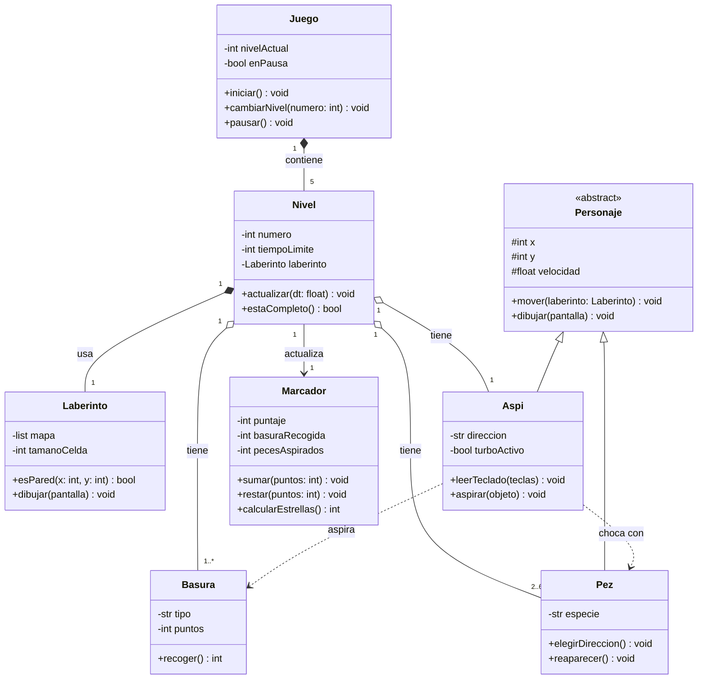

# Diagrama de clases

Clases principales del juego. Se programarán en **Python con pygame**: las clases que se dibujan en pantalla (Aspi, Pez, Basura) heredan de `pygame.sprite.Sprite`.

| Clase | Responsabilidad |
|---|---|
| Juego | Controla el ciclo principal de pygame, el cambio de niveles y la pausa. |
| Nivel | Guarda el tiempo, revisa si ya no queda basura y actualiza todo cada cuadro. |
| Laberinto | Lee el mapa (pasillos y paredes) y dice si una casilla es pared. |
| Personaje | Clase base abstracta con posición y movimiento; la heredan Aspi y Pez. |
| Aspi | La aspiradora del jugador; se mueve con el teclado y aspira lo que toca. |
| Pez | Nada solo por los pasillos; si Aspi lo toca, reaparece en otro lugar. |
| Basura | Objeto que da puntos al recogerse (lata, botella, bolsa, llanta). |
| Marcador | Lleva puntaje, basura recogida y peces aspirados, y calcula las estrellas. |

**Relaciones:** composición (◆) cuando la parte no existe sin el todo (un Nivel y su Laberinto); agregación (◇) cuando los objetos se crean y quitan durante el nivel (peces, basura); herencia (△) de Personaje a Aspi y Pez.
