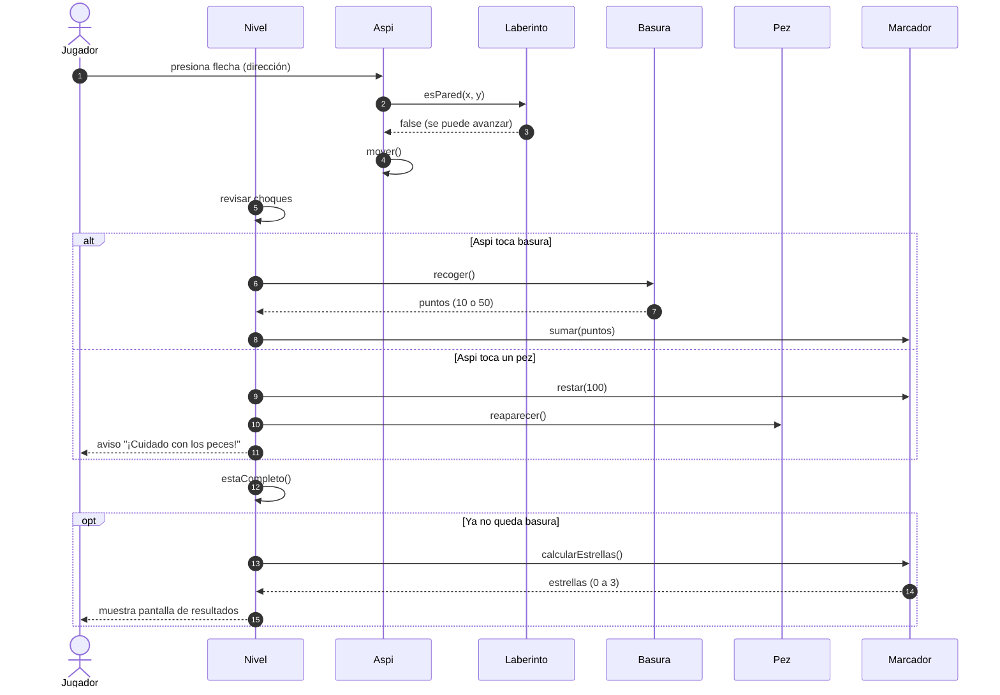

# Diagrama de secuencia: "Limpiar el laberinto"

Escenario principal del juego: el jugador mueve a Aspi, recoge basura y en un momento choca con un pez. Las flechas punteadas son mensajes de retorno.

**Relación con el SRS:** cubre RF-03 (mover a Aspi), RF-04 (recoger basura), RF-05 (penalización por pez) y RF-07 (resultados).
