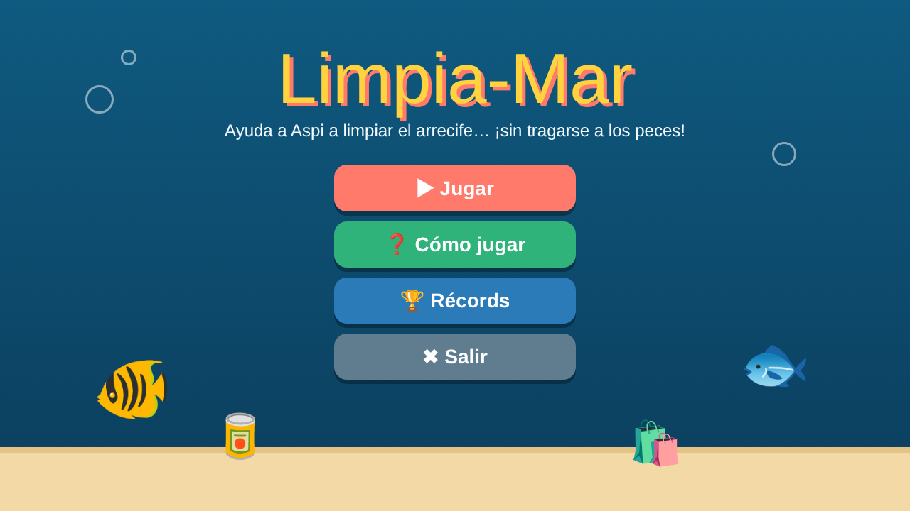
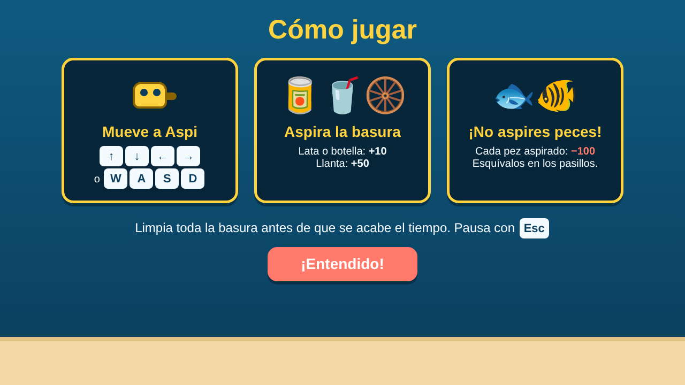
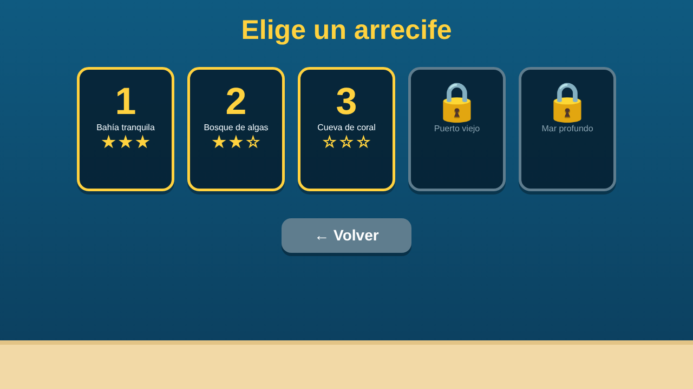
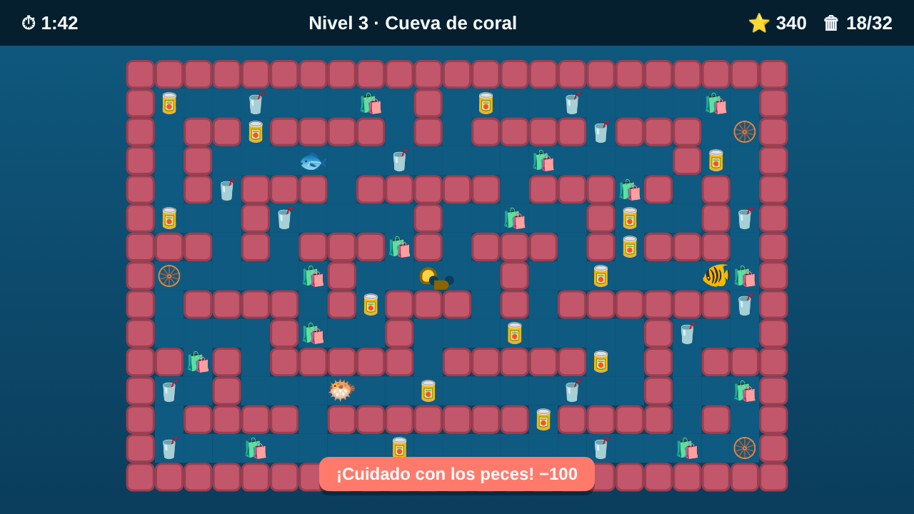
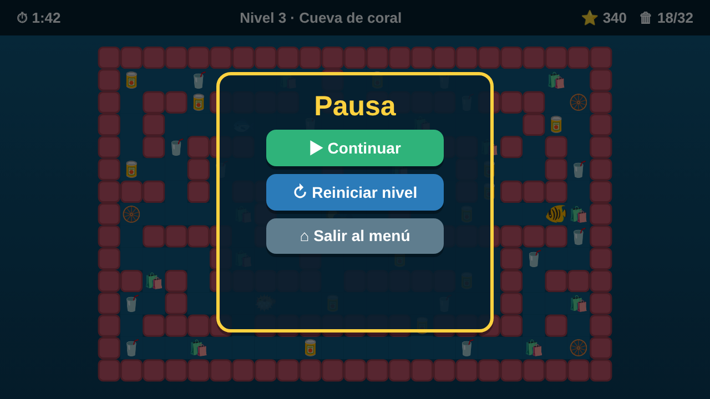
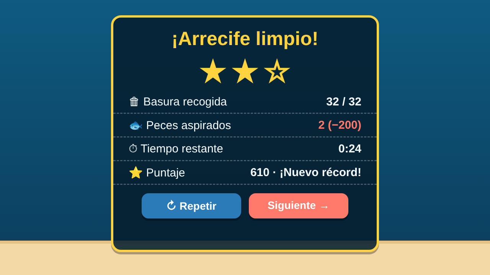

# 3. Diseño de pantallas

Herramienta: prototipo en **HTML y CSS** (se abre en el navegador y se puede navegar entre pantallas). Es solo el diseño; el juego final se programará en Python con pygame.

- Prototipo navegable: https://getze18.github.io/limpia-mar-analisis-diseno/3-pantallas/prototipo/
- Archivo fuente: [prototipo/index.html](prototipo/index.html)

| # | Pantalla | Imagen | Qué hace el jugador |
|---|---|---|---|
| 1 | Inicio |  | Elige Jugar, Cómo jugar, Récords o Salir (RF-01). |
| 2 | Cómo jugar |  | Aprende los controles y qué suma o resta puntos (RNF-02). |
| 3 | Selección de nivel |  | Escoge un arrecife desbloqueado (RF-02). |
| 4 | Juego |  | Mueve a Aspi, aspira basura y esquiva peces (RF-03 a RF-06). |
| 5 | Pausa |  | Continúa, reinicia o sale al menú (RF-08). |
| 6 | Resultados |  | Ve su puntaje, estrellas y récord (RF-07, RF-09). |
